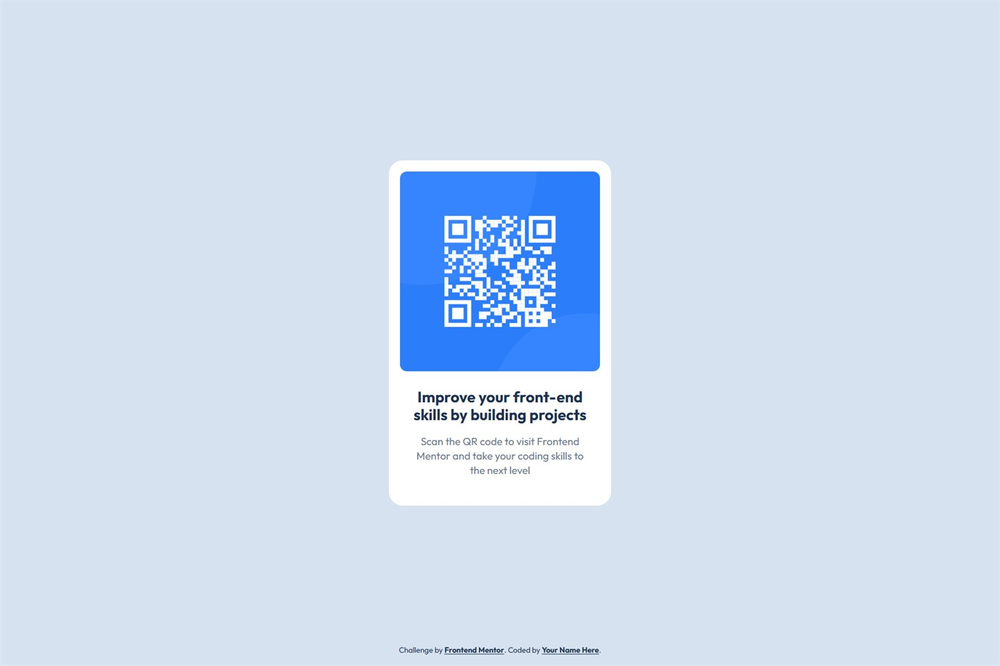

# Frontend Mentor - QR code component solution

This is a solution to the [QR code component challenge on Frontend Mentor](https://www.frontendmentor.io/challenges/qr-code-component-iux_sIO_H).
Frontend Mentor challenges help you improve your coding skills by building realistic projects.

## Table of contents

- [Overview](#overview)
  - [Screenshot](#screenshot)
  - [Links](#links)
- [My process](#my-process)
  - [Built with](#built-with)
  - [What I learned](#what-i-learned)
  - [Continued development](#continued-development)
  - [Useful resources](#useful-resources)
  - [AI Collaboration](#ai-collaboration)
- [Author](#author)
- [Acknowledgments](#acknowledgments)

## Overview

### Screenshot



### Links

- Solution URL: [GitHub repository](https://github.com/vicxxsotop-rgb/qr-code-component)
- Live Site URL: [vicxxsotop-rgb.github.io/qr-code-component](https://vicxxsotop-rgb.github.io/qr-code-component/)

## My process

I started with the content in HTML only (no styles), so the structure made sense on its
own. Then I built the styles from the outside in: page background and centering first,
then the card, and finally the typography.

To match the design I measured the reference JPGs pixel by pixel (card 320 × 498 px,
QR image 288 × 288 px, title 22 px / 700, body 15 px / 400) and compared them with the
rendered page until the difference was about 1 px.

### Built with

- Semantic HTML5 markup (`main` > `article` > `img` + `h1` + `p`)
- CSS custom properties for the design tokens (colors, radii)
- CSS Grid (`place-content: center`) to center the card
- BEM-style class names
- Google Fonts (Outfit, weights 400 and 700)
- No frameworks, no build step, no JavaScript

### What I learned

**Centering in both directions with Grid.** Instead of absolute positioning, the page
uses Grid, so the card stays centered on any screen without magic numbers:

```css
body {
  display: grid;
  place-content: center;
  min-height: 100dvh;
}
```

**The attribution is not part of the component.** It sits absolutely at the bottom of
the page, so it does not push the card off-center (that mistake moved the card 19 px up
compared to the design). On very short screens a media query returns it to the normal
flow so it never overlaps the card.

**Line height changes the whole layout.** Matching the title line height (25 px instead
of the default 28 px) made the card 498 px tall, exactly like the design.

**Accessibility is measurable.** Lighthouse flagged the footer text at a 3.46:1 contrast
ratio (below the 4.5:1 required by WCAG AA), so I darkened it. The final audit is
100 / 100 / 100 for accessibility, best practices and SEO.

### Continued development

- Fluid typography with `clamp()` for component titles.
- More components from Frontend Mentor to keep practising CSS Grid and accessibility.
- Setting up a small deploy workflow so every push publishes automatically.

### Useful resources

- [MDN - CSS Grid Layout](https://developer.mozilla.org/en-US/docs/Web/CSS/CSS_grid_layout) - clear reference for `place-content` and grid alignment.
- [CSS-Tricks - A Complete Guide to Grid](https://css-tricks.com/snippets/css/complete-guide-grid/) - visual explanations that made Grid click for me.
- [WebAIM Contrast Checker](https://webaim.org/resources/contrastchecker/) - used to verify the text colors against the background.
- [Google Fonts - Outfit](https://fonts.google.com/specimen/Outfit) - the typeface used in the design.

### AI Collaboration

I used **OpenCode** as an advisor and reviewer, not as a code generator: I wrote the
HTML and CSS myself and used the assistant to solve doubts, catch mistakes and make sure
the code was correct.

- **Solving doubts:** questions about specific CSS decisions, such as which semantic
  tags to use, how `place-content: center` works, and why the `line-height` of the title
  changed the height of the whole card.
- **Reviewing for errors:** it flagged a contrast ratio of 3.46:1 in the footer (below
  the 4.5:1 required by WCAG AA) and the attribution pushing the card 19 px off-center
  compared to the design.
- **Checking that it was well written:** layout checks at 320, 375, 768 and 1440 px
  widths, a Lighthouse audit (100 / 100 / 100), and a comparison against the reference
  JPGs to confirm the spacing matched within about 1 px.

What worked well: it was quick at spotting details I had missed (contrast, centering) and
at explaining the reason behind each fix. What I still had to do myself: decide which
changes to keep and check the result visually, because no automated test replaces looking
at the design.

## Author

- GitHub - [@vicxxsotop-rgb](https://github.com/vicxxsotop-rgb)
- Frontend Mentor - [@vicxxsotop-rgb](https://www.frontendmentor.io/profile/vicxxsotop-rgb)

## Acknowledgments

Thanks to [Frontend Mentor](https://www.frontendmentor.io) for the challenge and the
starter files, and to the community in the `#help` channel for the feedback.
